# Diagrama Completo de Funcionalidades - Publivende

**Actualizado:** Enero 2025  
**Versión:** 1.0

---

## 📊 Vista General de la Plataforma

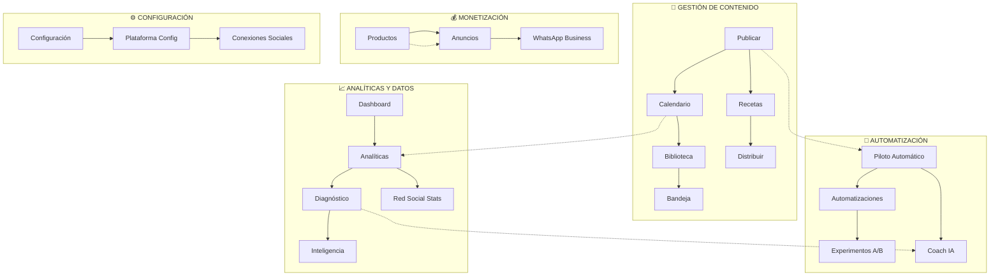

---

## 🎯 1. GESTIÓN DE CONTENIDO

### 1.1 Publicar (`_app.publicar.tsx`)
**Ruta:** `/publicar`

#### Funcionalidades Core:
- ✅ **Editor de Posts Multi-red**
  - Texto enriquecido con preview en tiempo real
  - Contador de caracteres por plataforma
  - Vista previa específica por red social
  - Emojis y formato básico

- ✅ **Gestión de Medios**
  - Upload múltiple de imágenes/videos
  - Redimensionamiento automático por red
  - Carrusel de imágenes para Instagram
  - Videos optimizados para cada plataforma

- ✅ **Selección de Redes**
  - Publicación simultánea multi-plataforma
  - Facebook, Instagram, TikTok, Twitter/X, LinkedIn
  - Configuración específica por red
  - Vista previa nativa de cada plataforma

- ✅ **Programación**
  - Fecha y hora específicas
  - Sugerencias de horarios óptimos basadas en IA
  - Cola de publicación
  - Zona horaria automática

- ✅ **Tipos de Post**
  - Post simple
  - Carrusel (Instagram)
  - Reels/Videos cortos
  - Historias (Stories)

```typescript
// Estructura de Post
interface Post {
  id: string;
  contenido: string;
  medios: Media[];
  redes: SocialNetwork[];
  fechaProgramada: Date;
  estado: "borrador" | "programado" | "publicado" | "fallido";
  tipoPost: "simple" | "carrusel" | "reel" | "historia";
}
```

---

### 1.2 Calendario (`_app.calendario.tsx`)
**Ruta:** `/calendario`

#### Funcionalidades Core:
- ✅ **Vista Mensual/Semanal/Diaria**
  - Navegación fluida entre vistas
  - Arrastrar y soltar posts
  - Color-coding por red social
  - Indicadores de estado

- ✅ **Filtros Avanzados**
  - Por red social
  - Por estado (borrador, programado, publicado)
  - Por tipo de contenido
  - Por etiquetas

- ✅ **Gestión Batch**
  - Selección múltiple
  - Reprogramación masiva
  - Duplicación de posts
  - Eliminación múltiple

- ✅ **Análisis de Distribución**
  - Densidad de publicaciones por día
  - Balance entre redes
  - Huecos en el calendario
  - Sugerencias de slots

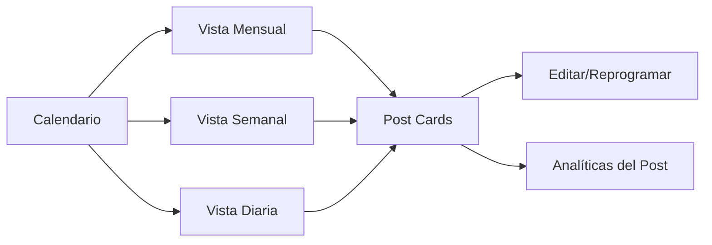

---

### 1.3 Biblioteca (`_app.biblioteca.tsx`)
**Ruta:** `/biblioteca`

#### Funcionalidades Core:
- ✅ **Asset Management**
  - Imágenes, videos, GIFs
  - Organización por carpetas/etiquetas
  - Búsqueda por contenido visual (IA)
  - Metadatos automáticos

- ✅ **Plantillas Reutilizables**
  - Plantillas de copy
  - Diseños predefinidos
  - Estructuras de carrusel
  - Historias guardadas

- ✅ **Historial de Posts Exitosos**
  - Top posts por engagement
  - Análisis de por qué funcionaron
  - Duplicar y adaptar
  - Archivo de mejores prácticas

- ✅ **Recursos de Marca**
  - Logos y variantes
  - Paleta de colores
  - Tipografías
  - Guidelines de marca

```typescript
// Estructura de Asset
interface LibraryAsset {
  id: string;
  tipo: "imagen" | "video" | "gif" | "plantilla";
  url: string;
  tags: string[];
  usageCount: number;
  avgEngagement?: number;
  createdAt: Date;
}
```

---

### 1.4 Bandeja (`_app.bandeja.tsx`)
**Ruta:** `/bandeja`

#### Funcionalidades Core:
- ✅ **Gestión de Borradores**
  - Lista de posts sin programar
  - Edición rápida
  - Conversión a programado
  - Eliminación

- ✅ **Revisión de Pendientes**
  - Posts esperando aprobación (piloto automático)
  - Comentarios para revisar
  - Mensajes directos
  - Notificaciones de redes

- ✅ **Estado de Publicaciones**
  - Posts programados próximos
  - Posts fallidos para reintentar
  - Historial de cambios
  - Log de errores

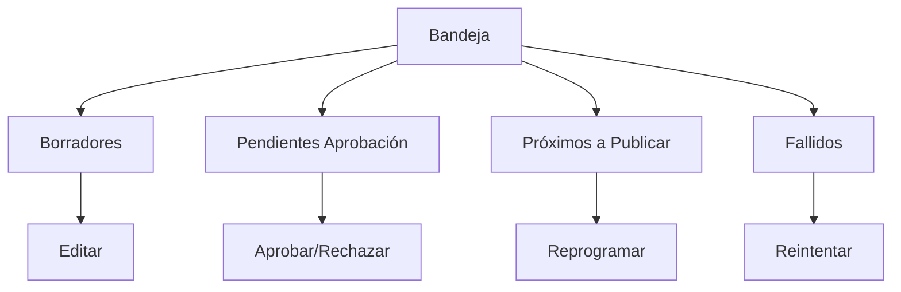

---

### 1.5 Recetas (`_app.recetas.tsx`)
**Ruta:** `/recetas`

#### Funcionalidades Core:
- ✅ **Frameworks de Contenido**
  - AIDA (Atención, Interés, Deseo, Acción)
  - PAS (Problema, Agitación, Solución)
  - BAB (Before, After, Bridge)
  - FAB (Features, Advantages, Benefits)
  - Storytelling narrativo

- ✅ **Plantillas por Objetivo**
  - Aumentar engagement
  - Generar ventas
  - Educar audiencia
  - Construir comunidad
  - Lanzamientos

- ✅ **Editor de Recetas Personalizadas**
  - Crear frameworks propios
  - Combinar elementos
  - Guardar variaciones
  - Compartir con equipo

- ✅ **Ejemplos y Casos de Uso**
  - Antes/después con resultados
  - Industria-específicos
  - Mejores prácticas por nicho
  - Análisis de efectividad

```typescript
// Estructura de Receta
interface Receta {
  id: string;
  nombre: string;
  descripcion: string;
  framework: "AIDA" | "PAS" | "BAB" | "FAB" | "custom";
  estructura: RecetaBloque[];
  objetivos: string[];
  industrias: string[];
  ejemplos: RecetaEjemplo[];
  metricas: RecetaMetricas;
}

interface RecetaBloque {
  orden: number;
  tipo: "gancho" | "desarrollo" | "beneficio" | "cta" | "custom";
  placeholder: string;
  tips: string[];
}
```

---

### 1.6 Distribuir (`_app.distribuir.tsx`)
**Ruta:** `/distribuir`

#### Funcionalidades Core:
- ✅ **Repurpose de Contenido**
  - Video largo → Clips cortos
  - Blog post → Thread de Twitter
  - Carrusel → Posts individuales
  - Podcast → Quotes visuales

- ✅ **Adaptación por Plataforma**
  - Reformateo automático
  - Ajuste de tono/lenguaje
  - Optimización de formato
  - Sugerencias de hashtags específicos

- ✅ **Cross-posting Inteligente**
  - Misma idea, múltiples versiones
  - Timing diferenciado por red
  - A/B testing cross-platform
  - Análisis comparativo

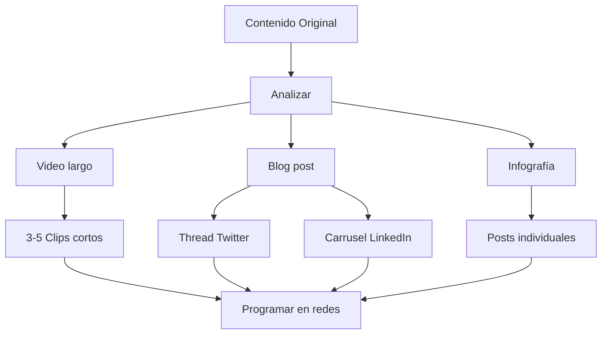

---

## 🤖 2. AUTOMATIZACIÓN

### 2.1 Piloto Automático (`_app.piloto.tsx`)
**Ruta:** `/piloto`

#### Funcionalidades Core:
- ✅ **Generación Automática de Contenido**
  - IA crea posts basados en contexto de negocio
  - Sugerencias diarias/semanales
  - Aprendizaje de estilo de marca
  - Adaptación a audiencia

- ✅ **Modo Aprobación vs Auto**
  - **Aprobación Manual:** Usuario revisa antes de publicar
  - **Auto:** IA publica directamente
  - Configuración por tipo de contenido
  - Reglas de seguridad

- ✅ **Contexto de Negocio**
  ```typescript
  interface BusinessContext {
    industria: string;
    audiencia: string;
    productsServices: string;
    usp: string;
    tonoMarca: string;
    valoresClaveñ string[];
  }
  ```

- ✅ **Slots de Publicación**
  - Días y horarios predefinidos
  - Frecuencia automática
  - Balance de contenido
  - Diversidad de formatos

- ✅ **Aprendizaje Continuo**
  - Análisis de rendimiento histórico
  - Optimización de horarios
  - Mejora de ganchos
  - Refinamiento de tono

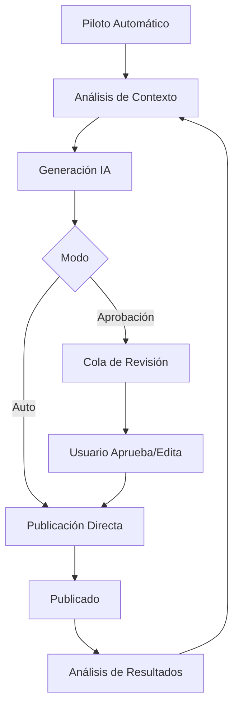

**Código del Sistema de Autopilot:**
```typescript
// src/server/autopilot/generate.ts
export async function generateAutopilotBatch(userId: string, targetSlots: number) {
  // 1. Obtener contexto de negocio
  const context = await getBusinessContextServer(userId);
  
  // 2. Calcular slots disponibles
  const slots = await computeAvailableSlots(userId, targetSlots);
  
  // 3. Analizar rendimiento histórico
  const diagnosis = await computeServerDiagnosis(userId);
  const aprendizajes = [
    ...diagnosis.topPosts.slice(0, 3).map(h => 
      `Gancho propio que funcionó (${h.vistas} vistas): "${h.gancho}"`
    ),
    ...diagnosis.comparativo.ganchos.filter(g => Math.abs(g.lift) >= 0.1)
  ];
  
  // 4. Generar copies con IA
  const aiCopies = await generateAutopilotCopiesOpenAI({
    businessContext: context,
    nicheBrief: nicheBrief(user.industria),
    tono: user.tonoMarca,
    aprendizajes,
    slots: slots.map((slot, i) => slotBrief(slot, i + 1))
  });
  
  // 5. Insertar posts en BD
  await db.insert(schema.posts).values(
    aiCopies.map(copy => ({
      userId,
      contenido: copy.texto,
      fechaProgramada: slots[copy.slotId - 1].date,
      estado: modoAprobacion ? "borrador" : "programado",
      autopilotEstado: modoAprobacion ? "pendiente" : "aprobado"
    }))
  );
}
```

---

### 2.2 Automatizaciones (`_app.automatizaciones.tsx`)
**Ruta:** `/automatizaciones`

#### Funcionalidades Core:
- ✅ **Respuestas Automáticas**
  - Comentarios frecuentes
  - DMs comunes
  - FAQ automatizado
  - Respuestas personalizadas por contexto

- ✅ **Reglas de Publicación**
  - Triggers basados en eventos
  - Publicar en momentos específicos
  - Reaccionar a tendencias
  - Alerts y notificaciones

- ✅ **Workflows Personalizados**
  - If-Then-Else logic
  - Encadenar acciones
  - Integraciones externas
  - Webhooks

- ✅ **Moderación Automática**
  - Filtrado de spam
  - Bloqueo de palabras
  - Detección de trolls
  - Escalado a humano

```typescript
interface Automatizacion {
  id: string;
  nombre: string;
  trigger: {
    tipo: "comentario" | "dm" | "mencion" | "hora" | "evento";
    condiciones: Condicion[];
  };
  acciones: Accion[];
  activa: boolean;
  stats: {
    ejecutada: number;
    exitosas: number;
    fallidas: number;
  };
}
```

---

### 2.3 Experimentos A/B (`_app.experimentos.tsx`)
**Ruta:** `/experimentos`

#### Funcionalidades Core:
- ✅ **Testing Multi-variante**
  - Títulos/ganchos diferentes
  - Imágenes alternativas
  - CTAs variations
  - Horarios de publicación

- ✅ **Configuración de Experimentos**
  - Definir variantes (A, B, C...)
  - Tamaño de muestra
  - Duración del test
  - Métrica objetivo

- ✅ **Análisis Estadístico**
  - Significancia estadística
  - Intervalos de confianza
  - Ganador declarado
  - Insights accionables

- ✅ **Aplicación Automática**
  - Rollout del ganador
  - Aprendizaje para futuro
  - Histórico de tests
  - Knowledge base

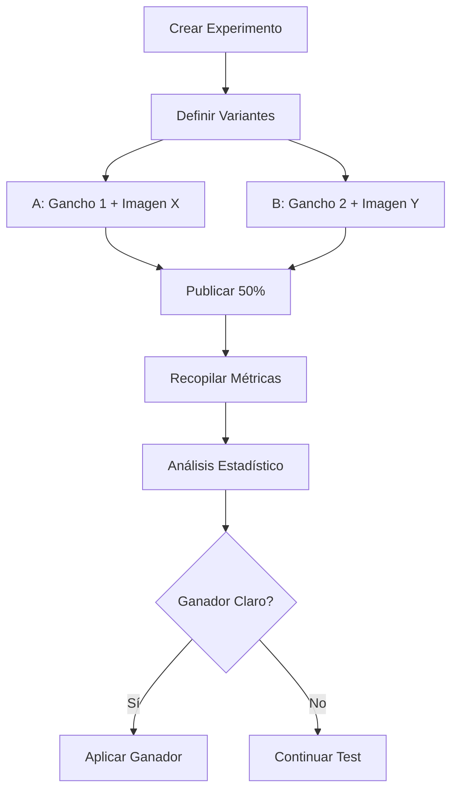

---

### 2.4 Coach IA (`_app.coach.tsx`)
**Ruta:** `/coach`

#### Funcionalidades Core:
- ✅ **Asistente Conversacional**
  - Chat en lenguaje natural
  - Sugerencias contextuales
  - Ayuda en tiempo real
  - Aprendizaje de preferencias

- ✅ **Mejora de Copy**
  - Análisis de texto
  - Sugerencias de reescritura
  - Optimización SEO/engagement
  - Corrección de errores

- ✅ **Recomendaciones Estratégicas**
  - Qué publicar y cuándo
  - Tendencias relevantes
  - Gaps en contenido
  - Oportunidades de crecimiento

- ✅ **Análisis de Rendimiento**
  - Explicación de métricas
  - Qué mejorar y cómo
  - Comparativas con competencia
  - Roadmap de optimización

```typescript
// Ejemplo de interacción
Usuario: "¿Por qué mi último post no funcionó?"

Coach IA: "Analicé tu post del 15 de enero:
- Publicaste a las 3pm, pero tu audiencia está más activa entre 7-9pm
- El gancho es débil: no genera curiosidad ni urgencia
- La imagen no destaca en el feed (colores apagados)
- Falta un CTA claro

Sugerencia: Republica con estas mejoras:
1. Nuevo gancho: '[Gancho optimizado]'
2. Publicar mañana a las 8pm
3. Usar imagen de tu biblioteca con +35% engagement"
```

---

## 📈 3. ANALÍTICAS Y DATOS

### 3.1 Dashboard (`_app.dashboard.tsx`)
**Ruta:** `/dashboard` (home)

#### Funcionalidades Core:
- ✅ **Vista General de Métricas**
  - Followers totales (all networks)
  - Engagement rate promedio
  - Posts programados
  - Alcance últimos 7/30 días

- ✅ **Gráficas de Crecimiento**
  - Followers over time
  - Engagement evolution
  - Post frequency
  - Best performing content types

- ✅ **Tareas Pendientes**
  - Posts para aprobar
  - Borradores sin programar
  - Comentarios sin responder
  - Acciones recomendadas

- ✅ **Quick Actions**
  - Crear post rápido
  - Ver calendario
  - Generar con IA
  - Revisar analíticas

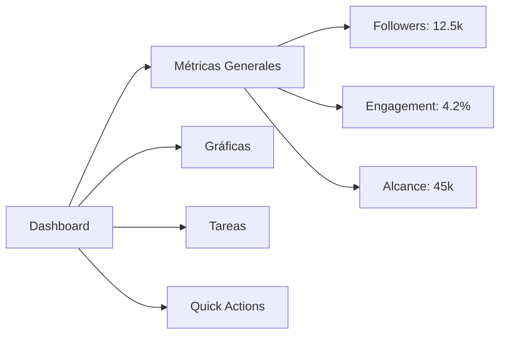

---

### 3.2 Analíticas (`_app.analiticas.tsx`)
**Ruta:** `/analiticas`

#### Funcionalidades Core:
- ✅ **Métricas Detalladas por Red**
  - Followers, reach, impressions
  - Engagement (likes, comments, shares)
  - Click-through rate
  - Save rate

- ✅ **Análisis de Posts**
  - Top posts por engagement
  - Worst performers
  - Patrones de éxito
  - Análisis de contenido

- ✅ **Demografía de Audiencia**
  - Edad y género
  - Ubicación geográfica
  - Intereses
  - Horarios de actividad

- ✅ **Comparativas**
  - Mes vs mes anterior
  - Año vs año anterior
  - Contra benchmarks de industria
  - Entre redes sociales

- ✅ **Exportación de Datos**
  - CSV/Excel
  - PDFs visuales
  - Reportes automáticos
  - Dashboards personalizados

```typescript
interface AnalyticsData {
  periodo: DateRange;
  metricas: {
    followers: number;
    reach: number;
    impressions: number;
    engagement: {
      rate: number;
      likes: number;
      comments: number;
      shares: number;
      saves: number;
    };
  };
  posts: PostAnalytics[];
  audiencia: AudienceData;
  tendencias: Trend[];
}
```

---

### 3.3 Diagnóstico (`_app.diagnostico.tsx`)
**Ruta:** `/diagnostico`

#### Funcionalidades Core:
- ✅ **Análisis de Salud de Cuenta**
  - Score general (0-100)
  - Frecuencia de publicación
  - Consistencia
  - Calidad de contenido

- ✅ **Identificación de Problemas**
  - Engagement bajo
  - Pérdida de followers
  - Alcance limitado
  - Problemas de timing

- ✅ **Oportunidades de Mejora**
  - Tipos de contenido infrautilizados
  - Horarios no explorados
  - Formatos con potencial
  - Temas trending relevantes

- ✅ **Plan de Acción Personalizado**
  - Pasos concretos
  - Priorización
  - Estimación de impacto
  - Timeline sugerido

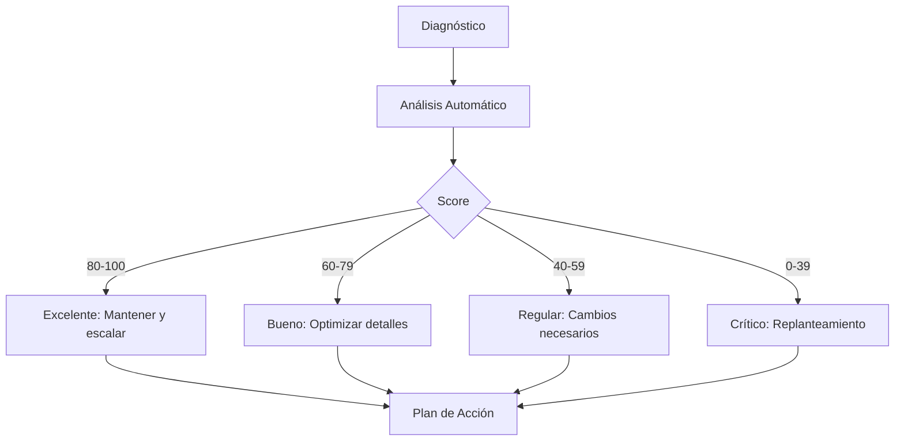

**Código del Sistema de Diagnóstico:**
```typescript
// src/server/diagnosis.ts
export async function computeServerDiagnosis(user: User) {
  const posts = await db.query.posts.findMany({
    where: eq(schema.posts.userId, user.id),
    orderBy: desc(schema.posts.fechaProgramada),
    limit: 100
  });
  
  // Calcular métricas clave
  const avgEngagement = posts.reduce((sum, p) => 
    sum + (p.vistas > 0 ? (p.likes + p.comentarios) / p.vistas : 0), 0
  ) / posts.length;
  
  const topPosts = posts
    .filter(p => p.vistas > 0)
    .sort((a, b) => b.vistas - a.vistas)
    .slice(0, 10);
  
  // Análisis de ganchos efectivos
  const ganchos = analyzeHooks(topPosts);
  
  // Comparativa con benchmarks del nicho
  const benchmarks = await getNicheBenchmarks(user.industria);
  
  return {
    score: calculateHealthScore(posts, avgEngagement, benchmarks),
    topPosts,
    ganchos,
    comparativo: {
      engagement: avgEngagement,
      industryAvg: benchmarks.engagement,
      lift: (avgEngagement - benchmarks.engagement) / benchmarks.engagement
    },
    recomendaciones: generateRecommendations(posts, benchmarks)
  };
}
```

---

### 3.4 Inteligencia (`_app.inteligencia.tsx`)
**Ruta:** `/inteligencia`

#### Funcionalidades Core:
- ✅ **Análisis de Competencia**
  - Monitoreo de cuentas competidoras
  - Qué están publicando
  - Qué les funciona
  - Gaps que puedes aprovechar

- ✅ **Trending Topics**
  - Tendencias en tu nicho
  - Hashtags emergentes
  - Temas virales relevantes
  - Oportunidades de contenido

- ✅ **Insights de Industria**
  - Benchmarks del sector
  - Mejores prácticas
  - Casos de estudio
  - Predicciones

- ✅ **Recomendaciones Estratégicas**
  - Colaboraciones sugeridas
  - Campañas potenciales
  - Nuevos formatos a explorar
  - Timing de lanzamientos

```typescript
interface InteligenciaData {
  competencia: CompetitorAnalysis[];
  trending: {
    topics: TrendingTopic[];
    hashtags: HashtagData[];
    formatos: FormatoTrending[];
  };
  benchmarks: IndustryBenchmark;
  oportunidades: Opportunity[];
}
```

---

### 3.5 Red (`_app.red.tsx`)
**Ruta:** `/red`

#### Funcionalidades Core:
- ✅ **Stats por Plataforma**
  - Vista individual de cada red conectada
  - Métricas nativas de la plataforma
  - Análisis comparativo
  - Salud de conexión API

- ✅ **Gestión de Conexiones**
  - Conectar/desconectar redes
  - Renovar tokens
  - Verificar permisos
  - Troubleshooting

- ✅ **Análisis Cross-platform**
  - Qué red funciona mejor para qué
  - Audiencia overlap
  - Sinergias entre plataformas
  - Estrategia multi-red

---

## 💰 4. MONETIZACIÓN

### 4.1 Productos (`_app.productos.tsx`)
**Ruta:** `/productos`

#### Funcionalidades Core:
- ✅ **Catálogo de Productos**
  - Crear fichas de productos/servicios
  - Imágenes y descripciones
  - Precios y variantes
  - Stock management

- ✅ **Taggeando en Posts**
  - Vincular productos a contenido
  - Shoppable posts
  - Link in bio optimizado
  - Tracking de conversiones

- ✅ **Análisis de Rendimiento**
  - Productos más mencionados
  - Conversiones por producto
  - ROI de contenido
  - Funnel de venta

```typescript
interface Producto {
  id: string;
  nombre: string;
  descripcion: string;
  imagenes: string[];
  precio: number;
  variantes?: Variante[];
  stock?: number;
  url: string;
  metricas: {
    menciones: number;
    clicks: number;
    conversiones: number;
    revenue: number;
  };
}
```

---

### 4.2 Anuncios (`_app.anuncios.tsx`)
**Ruta:** `/anuncios`

#### Funcionalidades Core:
- ✅ **Gestión de Campañas Pagadas**
  - Crear ads desde la plataforma
  - Meta Ads (Facebook/Instagram)
  - TikTok Ads
  - LinkedIn Ads

- ✅ **Boost de Posts**
  - Convertir posts orgánicos en ads
  - Configuración de audiencia
  - Presupuesto y duración
  - Optimización automática

- ✅ **Análisis de Campañas**
  - Métricas de ads
  - CPM, CPC, CPA
  - ROAS
  - Comparativa orgánico vs pagado

- ✅ **Recomendaciones de Presupuesto**
  - Sugerencias de inversión
  - Mejor momento para ads
  - Audiencias óptimas
  - Creative que funciona

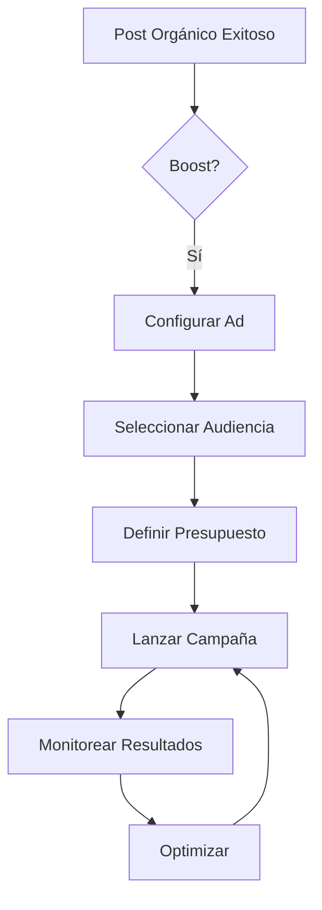

---

### 4.3 WhatsApp Business (`_app.whatsapp.tsx`)
**Ruta:** `/whatsapp`

#### Funcionalidades Core:
- ✅ **Integración con WhatsApp Business API**
  - Conexión de cuenta business
  - Verificación de número
  - Configuración de perfil
  - Permisos y compliance

- ✅ **Mensajes Automatizados**
  - Respuestas automáticas
  - Templates de mensajes
  - Bienvenida
  - Fuera de horario

- ✅ **Catálogo de Productos**
  - Sincronización con Productos
  - Envío de catálogos
  - Órdenes desde WhatsApp
  - Pagos integrados

- ✅ **Campañas de Broadcast**
  - Envío masivo segmentado
  - Templates aprobados
  - Métricas de entrega
  - Conversiones

- ✅ **Inbox y Gestión de Conversaciones**
  - Bandeja de entrada unificada
  - Etiquetas y organización
  - Asignación de chats
  - Histórico de conversaciones

```typescript
interface WhatsAppCampaign {
  id: string;
  nombre: string;
  template: WATemplate;
  audiencia: {
    segmento: string;
    count: number;
  };
  programacion: Date;
  metricas: {
    enviados: number;
    entregados: number;
    leidos: number;
    respuestas: number;
    conversiones: number;
  };
}
```

---

## ⚙️ 5. CONFIGURACIÓN

### 5.1 Configuración (`_app.configuracion.tsx`)
**Ruta:** `/configuracion`

#### Funcionalidades Core:
- ✅ **Perfil de Usuario**
  - Datos personales
  - Foto de perfil
  - Preferencias de idioma
  - Zona horaria

- ✅ **Configuración de Negocio**
  - Industria/nicho
  - Contexto de negocio
  - Tono de marca
  - Valores clave

- ✅ **Gestión de Redes Sociales**
  - Conectar/desconectar plataformas
  - Configurar permisos
  - Verificar estado de conexiones
  - Troubleshooting

- ✅ **Preferencias de Publicación**
  - Horarios predeterminados
  - Hashtags favoritos
  - Emojis recurrentes
  - Plantillas por defecto

- ✅ **Notificaciones**
  - Email notifications
  - Push notifications
  - Qué eventos notificar
  - Frecuencia

- ✅ **Billing y Suscripción**
  - Plan actual
  - Uso mensual
  - Upgrade/downgrade
  - Facturación

```typescript
interface UserSettings {
  profile: UserProfile;
  business: BusinessConfig;
  social: {
    facebook?: ConnectionStatus;
    instagram?: ConnectionStatus;
    tiktok?: ConnectionStatus;
    twitter?: ConnectionStatus;
    linkedin?: ConnectionStatus;
  };
  preferences: PublicationPreferences;
  notifications: NotificationSettings;
  subscription: SubscriptionInfo;
}
```

---

### 5.2 Plataforma (`_app.plataforma.tsx`)
**Ruta:** `/plataforma`

#### Funcionalidades Core:
- ✅ **Dashboard de Estado de Sistema**
  - Salud general de la plataforma
  - APIs conectadas y estado
  - Rate limits consumidos
  - Errores recientes

- ✅ **Integraciones Avanzadas**
  - Webhooks configurados
  - API keys propias
  - Conexiones custom
  - Zapier/Make/n8n

- ✅ **Developer Tools**
  - API documentation
  - Logs de requests
  - Testing de endpoints
  - Debug mode

- ✅ **Admin Features** (si aplica)
  - Gestión multi-usuario
  - Roles y permisos
  - Auditoría de acciones
  - Configuración avanzada

---

## 🔗 Flujos de Trabajo Principales

### Flujo 1: Crear y Publicar Contenido Manualmente
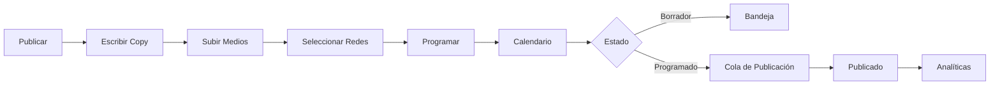

### Flujo 2: Piloto Automático End-to-End
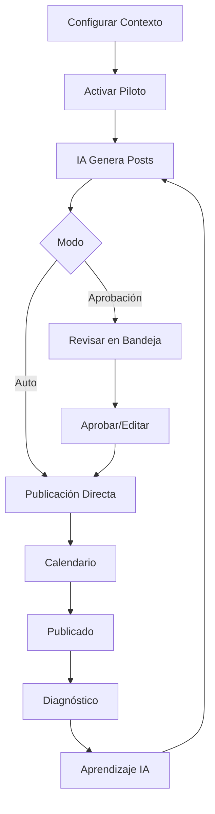

### Flujo 3: Optimización con IA
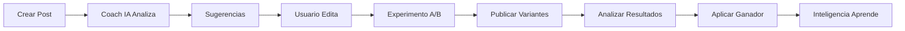

### Flujo 4: Monetización
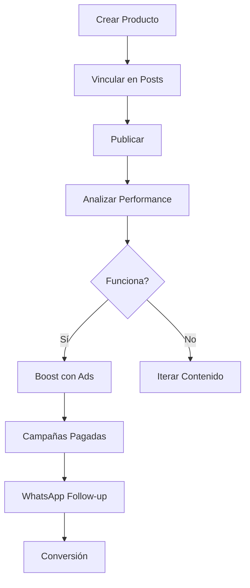

---

## 📱 Integraciones de Redes Sociales

### Plataformas Soportadas

| Red Social | Publicación | Analíticas | Stories | Ads | Estado |
|-----------|-------------|------------|---------|-----|--------|
| **Facebook** | ✅ | ✅ | ✅ | ✅ | Activo |
| **Instagram** | ✅ | ✅ | ✅ | ✅ | Activo |
| **TikTok** | ✅ | ✅ | ❌ | ✅ | Activo |
| **Twitter/X** | ✅ | ✅ | ❌ | ⚠️ | Activo |
| **LinkedIn** | ✅ | ✅ | ❌ | ✅ | Activo |
| **YouTube** | ⚠️ | ✅ | ❌ | ❌ | Parcial |
| **Pinterest** | 🔜 | 🔜 | ❌ | 🔜 | Próximo |

✅ = Completamente soportado  
⚠️ = Soporte parcial  
❌ = No soportado  
🔜 = En roadmap

---

## 🎨 Arquitectura de Datos Clave

### Modelo de Post Unificado
```typescript
interface Post {
  id: string;
  userId: string;
  contenido: string;
  medios: Media[];
  redes: {
    facebook?: PostNetwork;
    instagram?: PostNetwork;
    tiktok?: PostNetwork;
    twitter?: PostNetwork;
    linkedin?: PostNetwork;
  };
  fechaProgramada: Date;
  estado: "borrador" | "programado" | "publicado" | "fallido";
  tipoPost: "simple" | "carrusel" | "reel" | "historia";
  
  // Autopilot
  autopilotEstado?: "pendiente" | "aprobado" | "rechazado";
  autopilotAprobadoPor?: "auto" | "manual";
  autopilotGeneradoPor?: string;
  
  // Experimentos
  experimentoId?: string;
  varianteId?: string;
  
  // Productos
  productosVinculados?: string[];
  
  // Métricas
  vistas: number;
  likes: number;
  comentarios: number;
  compartidos: number;
  guardados: number;
  clicks: number;
  
  createdAt: Date;
  updatedAt: Date;
}

interface PostNetwork {
  plataforma: string;
  postId?: string;
  url?: string;
  estado: "pendiente" | "publicado" | "fallido";
  error?: string;
  metricas?: {
    vistas: number;
    engagement: number;
    // ... métricas específicas
  };
}
```

### Contexto de Usuario
```typescript
interface User {
  id: string;
  email: string;
  nombre: string;
  
  // Business Context
  industria: string;
  audiencia: string;
  productos: string;
  propuestaValor: string;
  tonoMarca: string;
  valores: string[];
  
  // Conexiones
  social: {
    facebook?: SocialConnection;
    instagram?: SocialConnection;
    tiktok?: SocialConnection;
    twitter?: SocialConnection;
    linkedin?: SocialConnection;
  };
  
  // Configuración Autopilot
  autopilotEnabled: boolean;
  autopilotMode: "aprobacion" | "auto";
  autopilotSlots: PilotSlot[];
  
  // Suscripción
  plan: "free" | "pro" | "enterprise";
  limites: {
    postsMonth: number;
    redesConectadas: number;
    autopilotPosts: number;
  };
  
  createdAt: Date;
}
```

---

## 🚀 Roadmap y Features Futuras

### Q1 2025
- [ ] Integración con Pinterest
- [ ] Editor de video en plataforma
- [ ] Análisis de sentimiento en comentarios
- [ ] Multi-usuario y equipos

### Q2 2025
- [ ] Integración con YouTube Shorts
- [ ] A/B testing avanzado (multivariate)
- [ ] Reporting personalizado con BI
- [ ] White-label para agencias

### Q3 2025
- [ ] Audio transcription y podcasts
- [ ] Generación de imágenes con IA
- [ ] Predictive analytics
- [ ] Marketplace de templates

### Q4 2025
- [ ] Mobile app (iOS/Android)
- [ ] Realidad aumentada en posts
- [ ] Integración con tiendas online
- [ ] API pública completa

---

## 📊 Métricas de Éxito de la Plataforma

### KPIs Principales
- **Usuarios Activos:** Posts publicados en últimos 30 días
- **Retention:** % de usuarios que vuelven mes a mes
- **Autopilot Adoption:** % de usuarios con piloto activo
- **Engagement Lift:** Mejora promedio en engagement tras usar la plataforma
- **Time Saved:** Horas ahorradas vs gestión manual

### Objetivos 2025
- 10,000 usuarios activos
- 85% retention mensual
- 60% autopilot adoption
- 40% promedio de engagement lift
- 15 horas ahorradas por usuario/mes

---

## 🔐 Seguridad y Privacidad

### Prácticas Implementadas
- ✅ Autenticación segura (OAuth 2.0)
- ✅ Encriptación de tokens de redes sociales
- ✅ Rate limiting en APIs
- ✅ Validación y sanitización de inputs
- ✅ HTTPS obligatorio
- ✅ GDPR compliant
- ✅ Backup automático diario
- ✅ Audit logs de acciones críticas

---

## 📞 Soporte y Documentación

### Recursos Disponibles
- **Documentación:** [docs.publivende.com]
- **Video Tutoriales:** [youtube.com/publivende]
- **Blog:** [blog.publivende.com]
- **Comunidad:** [community.publivende.com]
- **Soporte:** support@publivende.com
- **Status Page:** [status.publivende.com]

---

**Última actualización:** Enero 2025  
**Versión del documento:** 1.0  
**Mantenido por:** Equipo Publivende

---

Este diagrama representa el estado completo de Publivende al momento de la documentación. Para cambios o actualizaciones, consultar el repositorio oficial.
